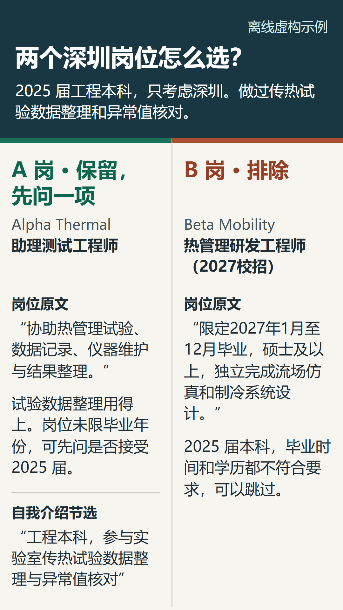

# Entry-Level Job Application Assistant

[中文](README.md)

Considering a campus or entry-level role you found on an employer’s website? Give your Agent the posting and two sentences about your background. It will check the work location and eligibility requirements, quote the posting, and tell you whether to proceed, ask a question, or skip the role.

**[Download the free complete bundle](downloads/entry-level-job-application-with-guide-candidate-20261119.zip)** · [Skill source](skills/entry-level-job-application). The skill instructions, detailed references and interactive guide are currently in Chinese. Unzip the bundle and follow `先看这里.txt` to load the skill into a compatible Agent. Model usage costs are separate. Replace the brackets and send this prompt.

> Use entry-level-job-application. Here is the employer’s posting: [link]. My graduation year is [year], my major is [major], and I’ve [one relevant experience]. Check the actual work location and eligibility requirements. Quote one line from the posting and tell me whether to proceed, ask about a specific condition, or skip it. Only check the role. Do not register, upload, or submit. If you can’t read the page, tell me and I can paste the job description.

<details>
<summary>Original Chinese prompt</summary>

> 使用 entry-level-job-application。这个官网岗位是【链接】。我【毕业届别、专业】，做过【一项相关经历】。请核对实际工作地和硬性资格，引用一条岗位原文，告诉我该继续、先问哪一项，还是跳过。只核岗位，不注册、不上传、不提交。官网读不到时告诉我，我可以贴出职位说明。

</details>

## What the result looks like

In the fictional offline example, a 2025 engineering graduate has experience organizing heat-transfer test data. Alpha Thermal’s assistant test engineer role is worth pursuing, with one question for the employer about eligibility for 2025 graduates. Skip Beta Mobility’s thermal R&D role. It requires a master’s degree or higher and a 2027 graduation date.



[Read the text version with the job excerpts and candidate introduction (Chinese)](docs/job-check-comparison.md)

## Support the author

The optional one-time payment is CNY 19.9. Check the product page for the current price. Both channels provide the same skill, Chinese guide and configuration examples. A purchase supports the author and provides the packaged files through SkillPay. It includes no human application service or hiring guarantee and grants no permission to access personal data or submit applications.

**Scan with Alipay to view the product and purchase**

On a computer, scan this QR code with the Alipay app on your phone. On a phone, save the image and use Alipay to recognize it.


[Product share link — open inside Alipay](https://render.alipay.com/p/yuyan/180020010001298808/product.html?caprMode=sync&merchantId=2088822673721480&productId=P0806000212843919). A desktop browser may only show an instruction to scan with Alipay.

## Optional interactive guide

The [customer bundle](downloads/entry-level-job-application-with-guide-candidate-20261119.zip) includes `guide.html`, a Chinese tutorial for setup and writing prompts. You can work directly in your Agent or use the guide to compose a request. The guide itself cannot search or apply. Older skill-only ZIPs omit it. If you only want text to review, use “Write a local draft only. Do not visit the application form or upload attachments.”

## After delivery or installation

When the Agent loads this skill after delivery, it explains capabilities, the minimum information needed, three ready-to-use prompts, and the optional guide. Specific tasks get a brief introduction instead; continuing a task does not repeat it. The instructions are self-contained even when no HTML attachment is delivered.

If your Agent only downloads the files, say: “After delivery, load entry-level-job-application and explain how I can start, including a guide link I can actually access.” This is a skill instruction, not a platform installation hook. Replace the marketplace delivery file separately and verify what customers receive.

## Get started

Copy the complete [skills/entry-level-job-application](skills/entry-level-job-application) folder into your Agent's skill directory, including its references, scripts, assets, and metadata. See the [client guide](skills/entry-level-job-application/references/clients.md) for documented host-specific paths and invocation syntax.

To discover new roles, tell the assistant where your resume is, what work you want, and what it may do.

> Use entry-level-job-application. Read my resume at [absolute path to my private resume] and find entry-level data analyst roles in Shanghai or Hangzhou. Compare verified opportunities and prepare drafts only. Do not register, upload, or submit. Ask together for any missing facts that affect the current step.

Specify which forms the Agent may fill and which files it may upload. At the final step it shows you the employer, role and selected files, then waits for you to submit. If you want the Agent to click for you, explicitly confirm at that moment, for example, “Submit this application for me now.” Each application needs its own confirmation. If the Agent finds a saved auto-submit preference, it identifies that setting and asks for fresh confirmation at the final step. Account registration still requires separate permission.

| Mode | Scope |
|---|---|
| Search and compare | Verify and rank opportunities; no registration, uploads, or submission |
| Prepare | Organize materials and draft within the authorized scope |
| Submit | You submit by default. The Agent can submit once after you explicitly confirm the application in front of you, then check the receipt |

## How it works

- Verify specific roles through employer websites or employer-linked recruitment systems. Keep evidence for personal facts and job details.
- Check eligibility before scoring fit. Default to up to three actionable choices with reasons, gaps, and a next step; expand scoring when useful. A score is not a hiring probability.
- Tailor the requested application content to documented experience and explain the changes. Reuse confirmed facts across similar roles.
- Keep the original resume and distinguish attachment purpose, role, language, and version. Check both appearance and extracted text of generated or edited PDFs; disclose checks the environment cannot perform.
- Save submission state and the material versions before clicking; reconcile with the official record afterward. Preserve submitted versions. An uncertain result does not trigger another submission.
- Hand off personal verification and unsupported steps with a concrete next action. CAPTCHA failures share a three-attempt ceiling; stricter site and tool restrictions take precedence.

Reuse capable existing tools. Automatically initialize missing Playwright MCP capability only when needed and authorized; add Windows-MCP only for necessary native Windows interaction. No persistent background service is created.

Optional Python standard-library helpers, `check_application.py` and `application_state.py`, check prepared application data and maintain an atomic private ledger. Simple searches do not need them. Without a usable Python runtime, use reliable private records instead of installing an environment just for the helpers. See [execution and recovery](skills/entry-level-job-application/references/execution.md) and the [evidence format](skills/entry-level-job-application/references/evidence.md).

## Local validation

From the repository root, using a verified local Python interpreter:

```text
python -m unittest discover -s tests -v
python tools/demo.py
```

On Windows, use the interpreter's actual path if needed to avoid Store aliases. The demo uses fictional data and does not log in or submit applications.

See [test coverage](TESTING.md), the [offline demo guide](docs/demo.md), and the [public project and user-feedback review](evaluation/competitive-review-2026-11-09.md). Documented configuration branches exist for Codex, Claude Code, DeepSeek Harness, and ZCode; they do not establish universal compatibility. Current evidence is local and simulated: live ATS submissions, every client integration, and marketplace purchase/delivery have not been verified.

Keep resumes, credentials, screenshots, and application records outside this public repository.
