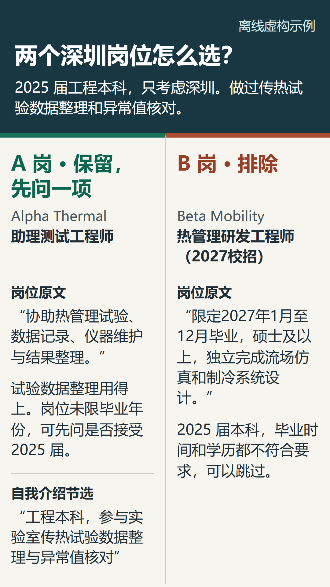
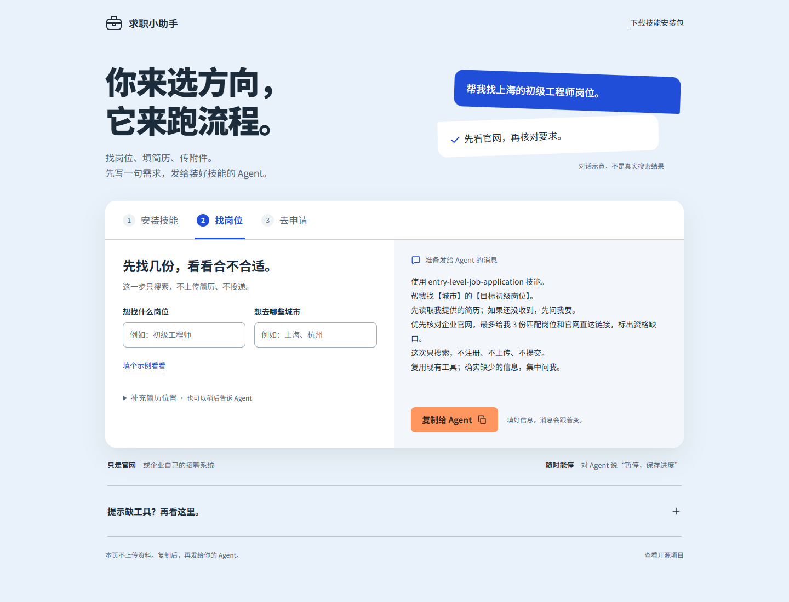

# 初级岗位求职助手

[English](README.en.md)

正在挑校招或初级岗位，手上已经有一条企业官网链接？给 Agent 这条链接和两句背景，它会核对实际工作地和硬性资格，引用岗位原文，帮你决定要不要继续、还要问清什么。

**[免费下载完整包（技能＋中文教程）](downloads/entry-level-job-application-with-guide-candidate-20261119.zip)** · [技能源码](skills/entry-level-job-application)。解压后按 `先看这里.txt` 把技能装进兼容的 Agent。模型使用费另计。填好括号，把这段发给 Agent 即可开始。

> 使用 entry-level-job-application。这个官网岗位是【链接】。我【毕业届别、专业】，做过【一项相关经历】。请核对实际工作地和硬性资格，引用一条岗位原文，告诉我该继续、先问哪一项，还是跳过。只核岗位，不注册、不上传、不提交。官网读不到时告诉我，我可以贴出职位说明。

## 核完岗位会看到什么



[阅读文字版、岗位原文和自我介绍节选](docs/job-check-comparison.md)

## 支持作者

一次性 ¥19.9，最终价格以商品页为准。免费获取和付费支持提供同一套技能、中文教程和配置示例。购买可通过 SkillPay 领取整理好的交付包并支持作者，不含人工代投或录用保证，也不授权读取个人资料或提交申请。

**用支付宝扫码查看商品并购买**

电脑浏览时，用手机支付宝扫描下方二维码；手机浏览时，可保存二维码后用支付宝识别。


[商品分享链接（请在支付宝内打开）](https://render.alipay.com/p/yuyan/180020010001298808/product.html?caprMode=sync&merchantId=2088822673721480&productId=P0806000212843919)。普通电脑浏览器打开此分享链接可能只显示“请使用支付宝扫码打开”。

## 交互教程

**[下载客户完整包（技能＋中文教程）](downloads/entry-level-job-application-with-guide-candidate-20261119.zip)**。解压后先看 `先看这里.txt`。

如果还没有收藏岗位，可以直接告诉 Agent 想找什么工作。它能查找各行业的初级岗位，按你的授权在企业官网或官方招聘系统准备申请，并记住进度。默认停在最后一步，由你本人提交。

`guide.html` 是[可选的使用教程](docs/starter-kit/README.md)，帮助新用户看安装步骤、生成可复制的需求话术。它自己不会搜索或投递；会用的用户直接跳过，不必先填网页。用 Edge 或 Chrome 打开即可，无需安装前端依赖。

客户完整包内有 `guide.html`；旧的单独技能 ZIP 不含教程。只想先看文案时，用这句限定范围：“只在本地写草稿，不访问招聘表单、不上传附件。”



## 领取后，Agent 会怎样教你使用

履约或安装后，Agent 加载本技能时会直接介绍能做什么、需要哪些资料、搜索/草稿/授权提交三种用法，并给出可复制的例句和可选教程入口。正常做任务时只给简短提示；已介绍过或继续上次任务时不重复。即使平台没有交付 HTML 附件，也可以直接在聊天中开始。

如果 Agent 只完成了下载、没有加载技能，把这句接在履约指令后，或单独发给它：

> 履约完成后，请加载 entry-level-job-application，按其中的首次使用说明告诉我怎么开始，并指出我能访问的教程入口。

Agent 加载技能后才会读到这段说明。更新仓库后，作者仍需单独替换 SkillPay 的交付文件，并核对客户实际收到的版本。

## 快速开始

1. 将完整的 [skills/entry-level-job-application](skills/entry-level-job-application) 文件夹放入当前 Agent 的技能目录，保留其中全部子目录，包括 `references/`、`scripts/`、`assets/` 和 `agents/`。各宿主路径见[安装与适配](skills/entry-level-job-application/references/clients.md)。
2. 想发现新岗位时，可以提供简历位置、目标和授权范围。

   > 使用 entry-level-job-application。我的简历在【简历文件的完整路径】，想找上海或杭州的初级数据分析岗位。请先读取简历，搜索并比较合适的岗位；只准备草稿，不上传、不注册、不提交。缺少影响筛选的信息时集中问我。

3. 需要填写官网表单或上传附件时，说明岗位范围和具体文件。助手会在最后一步列出公司、岗位和所用附件，等你本人提交。若想让它代交，请在看到这份最终申请时明确说“现在替我提交这份申请”。每次确认仅适用于眼前这一份。发现旧代投设置时，助手会指出该设置并要求当刻重新确认。必要账号注册仍需独立授权。助手复用已确认事实，只在当前步骤需要时补问，无需填写内部 JSON 或环境问卷。说“暂停”会停止后续动作，之后可以接着处理。

| 你要做什么 | 助手会做什么 |
|---|---|
| 找岗位、比较机会 | 搜索、核实官网信息和排序，不注册、不上传、不提交 |
| 准备申请 | 整理材料，在授权内填写草稿，区分本地内容和官网已保存状态 |
| 提交申请 | 默认由你本人提交。你在最后一步明确要求代交当前申请后，助手才会提交一次并核对回执 |

## 它怎样减少重复和误投

- **信息有来源**：核实具体岗位和官方渠道，填写内容对应用户资料；缺少事实不编造。
- **结论更好用**：默认给最多3个选择，说明优先推进、需要核实或不建议的原因及下一步；需要时再展开评分。
- **材料贴合岗位**：把岗位要求对应到真实经历，提供能直接使用的改写内容和简短改动说明；相近岗位不重复追问已确认事实。
- **附件不混用**：保留原简历，区分岗位、用途、语言及版本；生成或修改 PDF 后检查显示和可抽取文本，未验证项如实说明。
- **进度可恢复**：提交前保存状态及材料版本，确认当前候选人和岗位的官网回执后才记成功；历史投递内容不被新稿覆盖，超时先核查。
- **卡点可交接**：密码用已有可信管理器；本人验证或工具不支持时给出最小接手动作。同一验证码步骤最多三次失败，更严格限制优先，详见[验证码处理](skills/entry-level-job-application/references/captcha.md)。

搜索、浏览器和文件工具优先复用。只有本步确实缺少必要能力且已有授权时，助手才自动初始化 Playwright MCP；确需 Windows 原生窗口操作时再补 Windows-MCP。不会因运行在 Windows 就安装整套工具，不创建常驻后台服务。配置与权限要求见 [MCP 指南](skills/entry-level-job-application/references/mcp.md)。

提交阶段可选用仅依赖 Python 标准库的 `check_application.py` 和 `application_state.py`：前者检查助手整理的事实、附件和授权，后者用原子写入保存申请状态并检查重复投递。简单搜索不运行它们；没有 Python 时复用可靠的私有记录，不为辅助脚本单独安装环境。输入由助手整理，详见[执行与恢复](skills/entry-level-job-application/references/execution.md)及[证据格式](skills/entry-level-job-application/references/evidence.md)。

## 安装、验证与演示

已提供 Codex、Claude Code、DeepSeek Harness 和 ZCode 的文档适配分支；实际能力取决于宿主工具、权限和网站。`agents/openai.yaml` 只是 Codex 扩展，其他宿主读取通用技能正文。

在仓库根目录运行本地检查与虚构数据演示：

```text
python -m unittest discover -s tests -v
python tools/demo.py
```

这里的 `python` 指已确认的本地解释器，Windows 可替换为其实际路径，避免商店别名。演示不登录网站、不使用真实简历、不提交申请。

- [测试范围与记录](TESTING.md)
- [本轮参考的高关注项目与使用反馈](evaluation/competitive-review-2026-11-09.md)
- [离线演示说明](docs/demo.md)
- [完整技能说明](skills/entry-level-job-application/SKILL.md)
- [账号创建与恢复](skills/entry-level-job-application/references/accounts-and-recovery.md)
- [信息收集与隐私](skills/entry-level-job-application/references/intake-and-privacy.md)

当前证据来自本地检查及模拟场景；未验证真实 ATS 投递、所有客户端集成或第三方市场购买交付。简历、凭据、截图和申请记录应保存在用户授权的私有位置，不放入本仓库。
