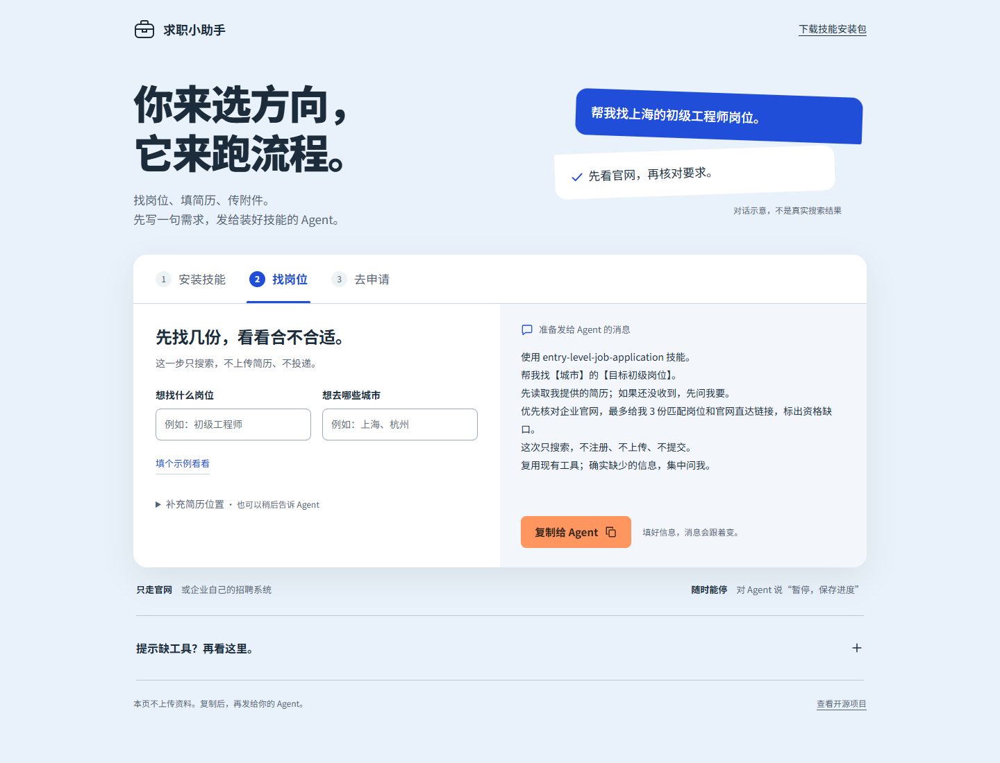

# 初级岗位求职助手

[English](README.en.md)

把简历、求职方向和授权范围交给 AI 助手，让它寻找合适的初级岗位，通过企业官网及官方招聘系统准备或提交申请，并记住进度。适用于各类企业，不限定行业；已有工具够用就直接开始。

这是可安装到 Agent 的技能，不是自行运行的投递机器人，也不保证录用。用户不用填写内部 JSON 或先完成一份环境问卷。

## 免费获取与购买支持

- **免费使用**：[技能源码](skills/entry-level-job-application) · [完整下载包（含中文教程）](downloads/entry-level-job-application-with-guide.zip)
- **支持作者**：[前往 SkillPay 购买](https://render.alipay.com/p/yuyan/180020010001298808/product.html?caprMode=sync&merchantId=2088822673721480&productId=P0806000212843919)，一次性 ¥19.9，最终价格以商品页为准。

两种渠道提供同一套技能，中文教程和配置示例也公开免费。付费可通过平台获取整理好的交付包并支持作者，没有付费独占功能。需自备兼容 Agent，模型费用另计；不包含人工代投或录用保证。

## 交互教程

**[下载客户完整包（技能＋中文教程）](downloads/entry-level-job-application-with-guide.zip)**。解压后先看 `先看这里.txt`。

**正常用法：装好技能，直接告诉 Agent 想找什么工作。**

`guide.html` 是[可选的使用教程](docs/starter-kit/README.md)，帮助新用户看安装步骤、生成可复制的需求话术。它自己不会搜索或投递；会用的用户直接跳过，不必先填网页。用 Edge 或 Chrome 打开即可，无需安装前端依赖。

客户完整包内有 `guide.html`；旧的单独技能 ZIP 不含教程。上架平台不会自动替换旧文件，客户实际收到的内容以平台交付包为准。



## 领取后，Agent 会怎样教你使用

履约或安装后，Agent 加载本技能时会直接介绍能做什么、需要哪些资料、搜索/草稿/授权提交三种用法，并给出可复制的例句和可选教程入口。正常做任务时只给简短提示；已介绍过或继续上次任务时不重复。即使平台没有交付 HTML 附件，也可以直接在聊天中开始。

如果 Agent 只完成了下载、没有加载技能，把这句接在履约指令后，或单独发给它：

> 履约完成后，请加载 entry-level-job-application，按其中的首次使用说明告诉我怎么开始，并指出我能访问的教程入口。

这段说明来自技能本身，不是平台安装钩子。更新本仓库不会自动替换 SkillPay 的旧商品文件，仍须上传新版并核对实际交付。

## 快速开始

1. 将完整的 [skills/entry-level-job-application](skills/entry-level-job-application) 文件夹放入当前 Agent 的技能目录，保留其中全部子目录，包括 `references/`、`scripts/`、`assets/` 和 `agents/`。各宿主路径见[安装与适配](skills/entry-level-job-application/references/clients.md)。
2. 提供简历位置、目标和授权范围。例如：

   > 使用 entry-level-job-application。我的简历在【简历文件的完整路径】，想找上海或杭州的初级数据分析岗位。请先读取简历，搜索并比较合适的岗位；只准备草稿，不上传、不注册、不提交。缺少影响筛选的信息时集中问我。

3. 需要代投时明确允许填写、上传和提交的范围；必要账号注册另按已有授权处理。助手复用已确认事实，只在当前步骤需要时补问。说“暂停”会停止后续动作，之后可以接着处理。

| 你要做什么 | 助手会做什么 |
|---|---|
| 找岗位、比较机会 | 搜索、核实官网信息和排序，不注册、不上传、不提交 |
| 准备申请 | 整理材料，在授权内填写草稿，区分本地内容和官网已保存状态 |
| 自动申请并提交 | 在持续授权范围内填写、上传、核对、提交，再处理下一机会 |

## 它怎样减少重复和误投

- **信息有来源**：核实具体岗位和官方渠道，填写内容对应用户资料；缺少事实不编造。
- **匹配有依据**：先检查硬性条件，再比较职业方向、经验和现实条件；未知偏好用评分区间，分数不是录用概率。
- **进度可恢复**：提交前保存状态，确认当前候选人和岗位的官网回执后才记成功；超时先核查，避免重复投递。
- **卡点可交接**：密码用已有可信管理器；本人验证或工具不支持时给出最小接手动作。同一验证码步骤最多三次失败，更严格限制优先，详见[验证码处理](skills/entry-level-job-application/references/captcha.md)。

搜索、浏览器和文件工具优先复用。只有本步确实缺少必要能力且已有授权时，助手才自动初始化 Playwright MCP；确需 Windows 原生窗口操作时再补 Windows-MCP。不会因运行在 Windows 就安装整套工具，不创建常驻后台服务。配置与权限要求见 [MCP 指南](skills/entry-level-job-application/references/mcp.md)。

提交阶段可选用仅依赖 Python 标准库的 `check_application.py` 和 `application_state.py`：前者检查助手整理的事实、附件和授权，后者用原子写入保存申请状态并检查重复投递。简单搜索不运行它们；没有 Python 时复用可靠的私有记录，不为辅助脚本单独安装环境。输入由助手整理，详见[执行与恢复](skills/entry-level-job-application/references/execution.md)及[证据格式](skills/entry-level-job-application/references/evidence.md)。

## 安装、验证与演示

已提供 Codex、Claude Code、DeepSeek Harness 和 ZCode 的文档适配分支；实际能力取决于宿主工具、权限和网站。文档适配不等于逐个客户端实测通过。`agents/openai.yaml` 只是 Codex 扩展，其他宿主读取通用技能正文。

在仓库根目录运行本地检查与虚构数据演示：

```text
python -m unittest discover -s tests -v
python tools/demo.py
```

这里的 `python` 指已确认的本地解释器，Windows 可替换为其实际路径，避免商店别名。演示不登录网站、不使用真实简历、不提交申请。

- [测试范围与记录](TESTING.md)
- [离线演示说明](docs/demo.md)
- [完整技能说明](skills/entry-level-job-application/SKILL.md)
- [账号创建与恢复](skills/entry-level-job-application/references/accounts-and-recovery.md)
- [信息收集与隐私](skills/entry-level-job-application/references/intake-and-privacy.md)

当前证据来自本地检查及模拟场景；未验证真实 ATS 投递、所有客户端集成或第三方市场购买交付。付费购买本技能也不代表授权读取个人资料或提交申请。简历、凭据、截图和申请记录应保存在用户授权的私有位置，不放入本仓库。
