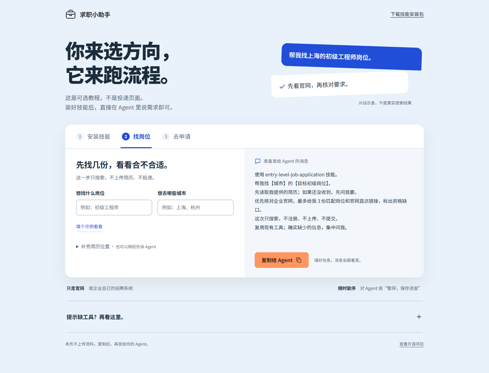

# 交互式上手教程



**装好技能后，直接告诉 Agent 你的求职需求就能用，不需要先填这个网页。**

[下载客户完整包（技能＋教程）](../../downloads/entry-level-job-application-with-guide.zip)。解压后先看 `先看这里.txt`，里面有中文使用说明和 `guide.html`。

`guide.html` 只是可选教程：教你安装、帮你写需求，再把文字复制给 Agent。页面自己不会搜索、读取简历或投递。第一次用可以看看，会用就跳过。

用 Edge 或 Chrome 打开 [guide.html](guide.html)；GitHub 的文件预览页只显示源码。旧的单独技能 ZIP 不带教程；平台是否交付新版完整包，需要在商品后台核对。

- **安装技能**：按客户端查看目录，下载同目录的技能安装 ZIP。
- **找岗位**：填岗位和城市，复制生成的消息给 Agent。
- **去申请**：选择只填草稿或允许提交，再写明岗位范围和附件。

缺工具时展开页面底部说明；已有工具够用就跳过安装。[配置示例](examples/README.md) 要合并，不能覆盖原设置。

页面离线可用，不上传、不保存个人资料，不执行实际投递。字体使用本机 Noto Sans SC 或系统中文字体，不同系统外观可能略有差异。

[一页速查 PDF](guide.pdf) · [技能安装包](entry-level-job-application.zip)

## 开发检查

页面只有 HTML、CSS 和原生 JavaScript，没有构建步骤和运行依赖。开发者若已有 Playwright，可在仓库根目录运行：

```text
node tools/test_guide.cjs
```

也可以传入已安装 Playwright 的模块路径和 Chrome 可执行文件路径：

```text
node tools/test_guide.cjs "<Playwright 模块路径>" "<Chrome 可执行文件路径>"
```

测试使用虚构输入，检查动态话术、草稿/提交范围、剪贴板回退、配置链接、键盘导航和窄屏布局，不安装依赖或访问招聘网站。教程用户不需要运行它。

维护者重新打包（使用已安装的 Python，客户不用运行）：

```text
python tools/package_skill.py --with-guide --output dist/entry-level-job-application-with-guide.zip
```

生成的客户包在根目录放置 `SKILL.md`、`先看这里.txt` 和 `guide.html`，不需要再解压第二个安装包。为避免覆盖旧交付文件，输出路径必须尚不存在。
